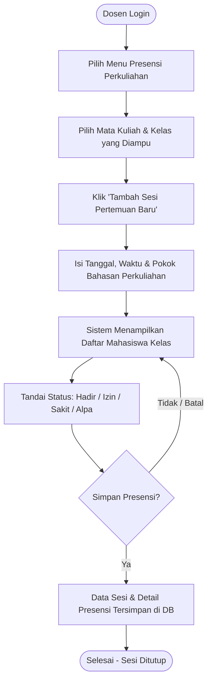
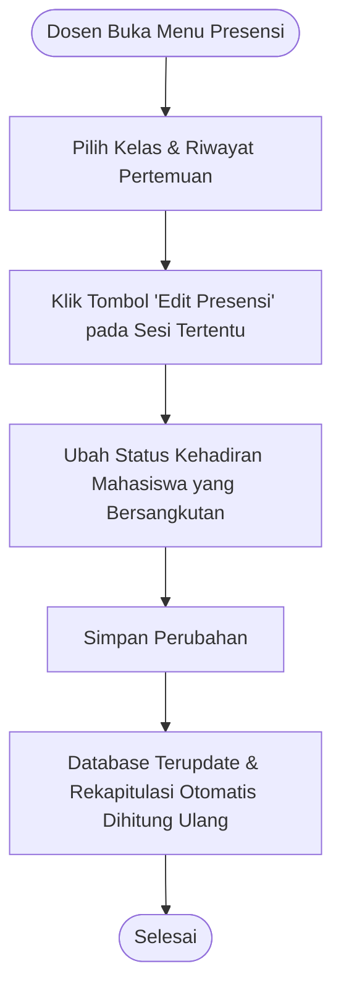
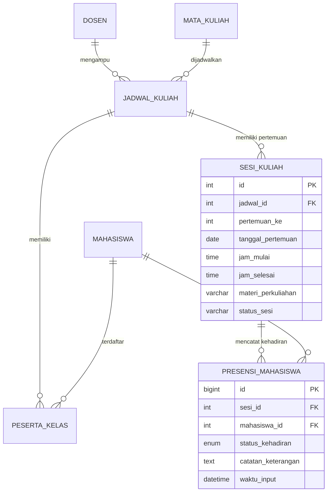

# Rencana Pengembangan & Skema Modul: Presensi Perkuliahan

**Modul:** Presensi Perkuliahan Mahasiswa  
**Author:** Adhim  
**Path:** `feature/adhim/`  
**Status Dokumen:** Proposed / Planned

---

## 1. Pendahuluan & Latar Belakang

Modul **Presensi Perkuliahan** bertujuan untuk mendigitalisasi proses pencatatan dan monitoring kehadiran mahasiswa dalam kegiatan belajar mengajar di perkuliahan. Modul ini berfokus pada kemudahan Dosen dalam menginput dan merevisi presensi setiap pertemuan kelas, serta menyajikan rekapitulasi kehadiran per mata kuliah secara akurat dan real-time untuk kebutuhan evaluasi akademik (seperti pemenuhan syarat minimal kehadiran ujian/UAS).

---

## 2. Cakupan Fitur Utama

Sesuai kebutuhan spesifikasi, modul ini mencakup 2 pilar fungsional utama:

### 2.1. Input & Edit Presensi Harian oleh Dosen

1. **Pemilihan Jadwal & Sesi Pertemuan:**
   - Dosen memilih mata kuliah dan kelas yang diampu.
   - Penentuan nomor pertemuan (Pertemuan ke-1 s/d 16).
   - Pengisian metadata perkuliahan: Tanggal, jam pelaksanaan, metode (Tatap Muka/Daring), serta pokok bahasan/materi kuliah.
2. **Form Presensi Cepat (Batch Input):**
   - Menampilkan daftar seluruh mahasiswa yang terdaftar di kelas (KRS disetujui).
   - Opsi default satu klik: **"Set Semua Hadir"** untuk efisiensi input.
   - Pilihan status kehadiran per mahasiswa:
     - `H` : Hadir
     - `I` : Izin (dilengkapi catatan keterangan / bukti)
     - `S` : Sakit (dilengkapi keterangan surat sakit)
     - `A` : Alpa / Tanpa Keterangan
3. **Edit & Revisi Presensi:**
   - Dosen dapat membuka kembali sesi perkuliahan yang sudah tersimpan untuk mengubah status kehadiran mahasiswa (misal: perubahan dari Alpa ke Izin).
   - Pencatatan log waktu update terakhir (`updated_at`) untuk menjaga integritas data.

### 2.2. Rekapitulasi Kehadiran per Mata Kuliah

1. **Matriks Kehadiran Komprehensif:**
   - Tampilan grid/tabel: Baris menampilkan Mahasiswa (NIM, Nama), Kolom menampilkan Pertemuan (P1 s/d P16).
   - Setiap sel menampilkan status kehadiran (`H`, `I`, `S`, `A`).
2. **Kalkulasi & Persentase Otomatis:**
   - Total Hadir, Izin, Sakit, Alpa per mahasiswa.
   - Persentase kehadiran:
     $$\text{Persentase Kehadiran} = \left(\frac{\text{Total Hadir}}{\text{Total Pertemuan Berjalan}}\right) \times 100\%$$
3. **Peringatan Ambang Batas (Attendance Warning):**
   - Penanda visual (badge merah/kuning) apabila persentase kehadiran mahasiswa di bawah batas minimum (misal: $< 75\%$ syarat mengikuti Ujian Akhir Semester).
4. **Filter & Export Data:**
   - Filter berdasarkan: Tahun Ajaran, Semester (Ganjil/Genap), Mata Kuliah, dan Kelas.
   - Fitur ekspor laporan ke format Excel (`.xlsx`) dan cetak PDF untuk arsip Program Studi / BAAK.

---

## 3. Aktor & Hak Akses (Role & Permission)

| Role                | Hak Akses Fungsional                                                                                                                                                                                   |
| :------------------ | :----------------------------------------------------------------------------------------------------------------------------------------------------------------------------------------------------- |
| **Dosen**           | - Membuka sesi pertemuan perkuliahan. - Mengisi presensi harian mahasiswa di kelasnya. - Mengedit data presensi pertemuan sebelumnya. - Melihat dan mencetak rekapitulasi kehadiran kelasnya. |
| **Mahasiswa**       | - Melihat riwayat kehadiran pribadi pada mata kuliah yang diambil. - Memantau sisa kuota ketidakhadiran sebelum batas $75\%$.                                                                       |
| **Admin / Kaprodi** | - Memantau rekapitulasi kehadiran seluruh mata kuliah & dosen. - Mengunduh laporan presensi tingkat program studi.                                                                                  |

---

## 4. Alur Kerja Sistem (Workflow)

### 4.1. Alur Input Presensi Harian oleh Dosen

### 4.2. Alur Edit Presensi

---

## 5. Perancangan Skema Database (Database Design)

Berikut adalah struktur entitas basis data pendukung dan relasi untuk modul Presensi Perkuliahan:

### 5.1. Struktur Tabel Terkait

### 5.2. Deskripsi Entitas Modul Utama

#### 1. Tabel `sesi_kuliah` (Header Sesi Presensi)

Menyimpan informasi sesi per pertemuan yang dibuat oleh dosen.

- `id` (INT, Primary Key, Auto Increment)
- `jadwal_id` (INT, Foreign Key ke tabel jadwal/kelas)
- `dosen_id` (INT, Foreign Key ke tabel dosen yang menginput)
- `pertemuan_ke` (TINYINT, 1 s/d 16)
- `tanggal_pertemuan` (DATE)
- `jam_mulai` (TIME)
- `jam_selesai` (TIME)
- `materi_perkuliahan` (VARCHAR/TEXT, deskripsi materi ajar)
- `status_sesi` (ENUM: `'dibuka'`, `'selesai'`, `'dibatalkan'`)
- `created_at` (TIMESTAMP)
- `updated_at` (TIMESTAMP)

#### 2. Tabel `presensi_mahasiswa` (Detail Presensi per Mahasiswa)

Menyimpan catatan status kehadiran per individu mahasiswa per sesi.

- `id` (BIGINT, Primary Key, Auto Increment)
- `sesi_id` (INT, Foreign Key ke `sesi_kuliah.id`, ON DELETE CASCADE)
- `mahasiswa_id` (INT, Foreign Key ke tabel `mahasiswa.id`)
- `status_kehadiran` (ENUM: `'H'`, `'I'`, `'S'`, `'A'`)
- `catatan_keterangan` (VARCHAR(255), opsional misal nomor surat izin/sakit)
- `created_at` (TIMESTAMP)
- `updated_at` (TIMESTAMP)
- _Constraint Unique:_ `(sesi_id, mahasiswa_id)` — mencegah duplikasi presensi mahasiswa pada sesi yang sama.

---

## 6. Rencana Desain Antarmuka (UI/UX)

1. **Halaman 1: Dashboard Daftar Mata Kuliah Diampu (Dosen)**
   - Menampilkan card mata kuliah aktif semester berjalan.
   - Informasi jumlah mahasiswa, progres pertemuan (misal: 6/16 pertemuan terlaksana), dan tombol cepat **"Input Presensi"** serta **"Lihat Rekap"**.
2. **Halaman 2: Form Input / Edit Presensi Harian**
   - Header form: Info Mata Kuliah, Kelas, Tanggal, dan Input Materi Kuliah.
   - Tombol Aksi Cepat: `[Tandai Semua Hadir]`, `[Reset Form]`.
   - Tabel Daftar Mahasiswa:
     - Kolom: No, NIM, Nama Mahasiswa, Radio Button Status (`[H]`, `[I]`, `[S]`, `[A]`), Input Catatan.
   - Footer: Tombol `[Simpan Presensi]` dan `[Batal / Kembali]`.
3. **Halaman 3: Rekapitulasi Kehadiran Kelas**
   - Filter: Semester, Mata Kuliah, Kelas.
   - Tabel Matriks:
     - Header pertemuan: P1 | P2 | P3 | ... | P16 | Total H | Total I | Total S | Total A | % Kehadiran | Status.
   - Visualisasi: Baris mahasiswa dengan kehadiran $< 75\%$ ditandai warna highlight khusus (Warning UAS).
   - Tombol Ekspor: `[Export Excel]` dan `[Print PDF]`.

---

## 7. Rencana Tahapan Implementasi (Roadmap)

| Fase                                | Kegiatan                                                                                           | Target Output                                          |
| :---------------------------------- | :------------------------------------------------------------------------------------------------- | :----------------------------------------------------- |
| **Fase 1: Database**                | Menyusun DDL SQL untuk tabel `sesi_kuliah` dan `presensi_mahasiswa` pada file `schema.sql`.        | File `feature/adhim/schema.sql` siap dieksekusi.       |
| **Fase 2: Mockup & UI**             | Pembuatan template antarmuka form input presensi dan tabel rekap kehadiran.                        | Halaman HTML responsif (Bootstrap/Tailwind).           |
| **Fase 3: Backend & CRUD Presensi** | Pembuatan logika create, read, update presensi pertemuan harian.                                   | Endpoint/controller input dan edit presensi berfungsi. |
| **Fase 4: Modul Rekapitulasi**      | Query agregasi untuk matriks kehadiran pertemuan 1-16 dan kalkulasi persentase kehadiran.          | Tabel rekapitulasi dinamis dengan kalkulasi akurat.    |
| **Fase 5: Testing & Validasi**      | Uji coba skenario presensi (duplikasi, update status, perhitungan persentase, boundary limit 75%). | Modul siap integrasi dengan branch utama.              |
